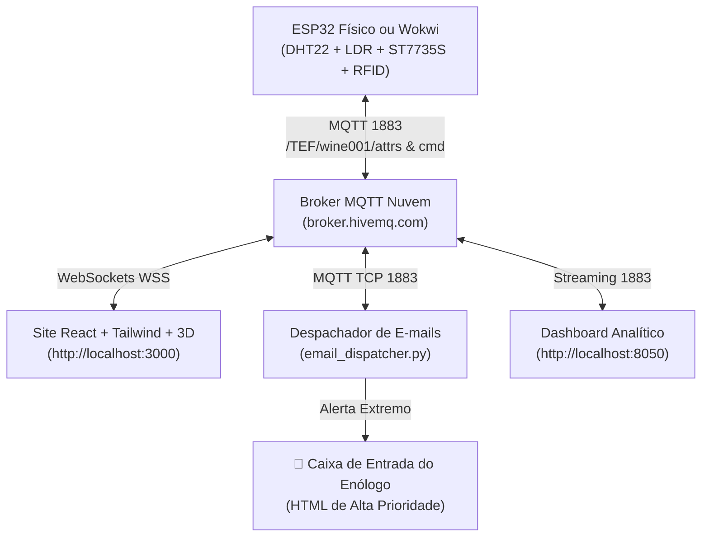

# 🍷 MANUAL DE MONTAGEM FÍSICA DO HARDWARE, PINAGEM & VINCULAÇÃO COM O SITE
### **VinheriaTech • Equipe Prisma | Check Point 5 (IoT & Cloud Computing)**
**Orientador:** Prof. Dr. Fábio Henrique Cabrini

---

## 📌 1. Visão Geral dos Componentes

Neste projeto de missão crítica para conservação de vinhos nobres, integramos sensores industriais, atuadores sonoros/visuais graduados, leitor RFID para auditoria e o **Módulo Display Colorido 0.96" SPI (Controlador ST7735S - 80x160 pixels)**.

### 📋 Lista de Materiais:
1. **1x Placa de Desenvolvimento ESP32** (30 ou 38 pinos NodeMCU-32S / DOIT DevKit).
2. **1x Módulo Display Colorido 0.96" ST7735S** (8 pinos: `VCC`, `GND`, `SCK`, `MOSI`, `CS`, `D/C`, `RES`, `BLK`).
3. **1x Sensor de Temperatura e Umidade DHT-22** (ou DHT-11).
4. **1x Sensor de Luminosidade LDR 5mm** + **1x Resistor de 10 kΩ** (divisor de tensão).
5. **1x Buzzer Piezoelétrico** (Multi-frequência acionado por PWM).
6. **1x LED Azul Difuso 5mm** + **1x Resistor de 220 Ω**.
7. **1x Módulo Leitor RFID MFRC522 (13.56 MHz)** + **1x Tag/Cartão Master (UID: `01:02:03:04`)**.
8. **1x Protoboard de 830 pontos** + Jumpers Macho-Macho e Macho-Fêmea.
9. **1x Cabo Micro-USB / USB-C** com suporte a transferência de dados.

---

## 🔌 2. Tabela de Pinagem Completa (Porta a Porta)

Como temos **dois periféricos de alta performance que utilizam o barramento SPI** (o *Display Colorido ST7735S* e o *Leitor RFID MFRC522*), eles **compartilham as linhas de Clock (`SCK`) e Dados (`MOSI`)**, mantendo pinos de Chip Select (`CS`) e Reset independentes no ESP32:

```
                  ┌───────────────────────────────┐
                  │      ESP32 (Barramento SPI)   │
                  │   SCK (GPIO 18)   MOSI (GPIO 23)
                  └──────┬────────────────┬───────┘
                         │                │
            ┌────────────┴──┐        ┌────┴──────────┐
            │ Display ST7735│        │ RFID MFRC522  │
            │ SCK  ← GPIO 18│        │ SCK  ← GPIO 18│
            │ MOSI ← GPIO 23│        │ MOSI ← GPIO 23│
            │ CS   ← GPIO 15│        │ SDA  ← GPIO 5 │
            │ DC   ← GPIO 4 │        │ MISO ← GPIO 19│
            │ RST  ← GPIO 22│        │ RST  ← GPIO 27│
            └───────────────┘        └───────────────┘
```

---

### 🖥️ Módulo 1: Display Colorido 0.96" (ST7735S - 80x160 SPI)
> [!IMPORTANT]
> O pino **BLK** controla o LED de retroiluminação (backlight). Ele pode ser ligado direto em `3.3V` ou no `VCC`.

| Pino do Display | Função | Ligação no ESP32 | Ligação no Arduino Uno | Observações |
| :--- | :--- | :--- | :--- | :--- |
| **VCC** | Alimentação | **3.3V** (ou 5V) | 5V ou 3.3V | Suporta 3.3V e 5V |
| **GND** | Terra Comum | **GND** | GND | Linha negativa comum |
| **SCK** | SPI Clock | **GPIO 18** | **Pino 13** | Compartilhado com o RFID |
| **MOSI (SDA)** | SPI Data In | **GPIO 23** | **Pino 11** | Compartilhado com o RFID |
| **CS** | Chip Select da Tela | **GPIO 15** | **Pino 10** | Pino exclusivo da tela |
| **D/C (DC)** | Data / Command | **GPIO 4** (ou 21) | **Pino 9** | Controle de comando gráfico |
| **RES (RST)** | Reset de Hardware | **GPIO 22** (ou 14) | **Pino 8** | Reset do controlador |
| **BLK** | Backlight (Luz de fundo) | **3.3V** | 3.3V | Mantém a tela iluminada |

---

### 🏷️ Módulo 2: Leitor RFID MFRC522 (13.56 MHz SPI)
> [!CAUTION]
> **ATENÇÃO MÁXIMA:** O leitor MFRC522 opera **exclusivamente em 3.3V**. Ligar o pino VCC do RFID em 5V queimará o circuito integrado na hora!

| Pino do RFID RC522 | Função | Ligação no ESP32 | Ligação no Arduino Uno | Observações |
| :--- | :--- | :--- | :--- | :--- |
| **3.3V (VCC)** | Alimentação | **3.3V** | **3.3V** | **NUNCA ligar no 5V!** |
| **RST** | Reset | **GPIO 27** | **Pino 7** | Reset de inicialização |
| **GND** | Terra Comum | **GND** | GND | Terra comum |
| **IRQ** | Interrupção | *Não Conectado* | *Não Conectado* | Deixar livre |
| **MISO** | SPI Data Out | **GPIO 19** | **Pino 12** | Leitura de tags |
| **MOSI** | SPI Data In | **GPIO 23** | **Pino 11** | Compartilhado com o Display |
| **SCK** | SPI Clock | **GPIO 18** | **Pino 13** | Compartilhado com o Display |
| **SDA (SS / CS)** | Chip Select RFID | **GPIO 5** | **Pino 10** | Exclusivo do RFID |

---

### 🌡️ Módulo 3: Sensores (DHT-22 e LDR)

| Sensor | Pino do Sensor | Ligação no ESP32 | Ligação no Arduino Uno | Observações |
| :--- | :--- | :--- | :--- | :--- |
| **DHT-22** | VCC (+) | **3.3V** (ou 5V) | 5V | Alimentação |
| **DHT-22** | DATA (Sinal) | **GPIO 4** (ou 16) | **Pino 2** | Leitura de Temperatura e Umidade |
| **DHT-22** | GND (-) | **GND** | GND | Terra |
| **LDR (Luz)** | Terminal 1 | **3.3V** | 5V | Uma perna do LDR no 3.3V |
| **LDR (Luz)** | Terminal 2 (Divisor) | **GPIO 34 (ADC1)** | **Pino A0** | Ponto médio com Resistor 10kΩ |
| **Resistor 10kΩ** | Extremidade | **GND** | GND | Completa o divisor de tensão |

---

### 🔊 Módulo 4: Atuadores de Alerta (Buzzer & LED Azul)

| Atuador | Terminal | Ligação no ESP32 | Ligação no Arduino Uno | Observações |
| :--- | :--- | :--- | :--- | :--- |
| **Buzzer** | Positivo (+) | **GPIO 13** | **Pino 6** (PWM) | Multi-tom via PWM |
| **Buzzer** | Negativo (-) | **GND** | GND | Terra |
| **LED Azul** | Anodo (+) | **GPIO 2** | **Pino 5** | Através de resistor de 220 Ω |
| **LED Azul** | Catodo (-) | **GND** | GND | Terra |

---

## 🛠️ 3. Passo a Passo de Montagem na Protoboard

1. **Desconecte o cabo USB do ESP32** antes de iniciar qualquer ligação.
2. Encaixe o ESP32 na protoboard com o conector USB voltado para a borda.
3. Ligue as trilhas de alimentação da protoboard:
   * Conecte o pino **`3.3V`** do ESP32 na trilha vermelha (`+`).
   * Conecte o pino **`GND`** do ESP32 na trilha azul/preta (`-`).
4. **Ligue o Barramento SPI compartilhado:**
   * Puxe um jumper do **GPIO 18 (SCK)** para o pino `SCK` do Display e outro para o `SCK` do RFID.
   * Puxe um jumper do **GPIO 23 (MOSI)** para o pino `MOSI` do Display e outro para o `MOSI` do RFID.
5. **Ligue os pinos de controle independentes:**
   * Display `CS` $\to$ GPIO 15 | `D/C` $\to$ GPIO 4 | `RES` $\to$ GPIO 22 | `BLK` $\to$ 3.3V.
   * RFID `SDA (CS)` $\to$ GPIO 5 | `MISO` $\to$ GPIO 19 | `RST` $\to$ GPIO 27.
6. **Ligue o DHT-22 e o divisor de tensão do LDR:**
   * Insira o LDR na protoboard. Uma perna vai ao 3.3V, a outra perna vai ao **GPIO 34**. Na mesma perna do GPIO 34, insira o resistor de 10kΩ indo para o **GND**.
7. **Ligue o Buzzer e o LED Azul:**
   * Ligue o positivo do LED Azul no resistor de 220Ω e este no **GPIO 2**; o chanfro negativo no GND.
   * Ligue o positivo do Buzzer no **GPIO 13** e o negativo no GND.
8. Revise todas as conexões antes de ligar a alimentação USB.

---

## 💻 4. Bibliotecas Necessárias no Arduino IDE

No Arduino IDE, abra o **Library Manager** (`Ctrl + Shift + I`) e instale:
1. **Adafruit ST7735 and ST7789 Library** (por Adafruit)
2. **Adafruit GFX Library** (por Adafruit)
3. **MFRC522** (por GithubCommunity)
4. **DHT sensor library** (por Adafruit)
5. **PubSubClient** (por Nick O'Leary)

---

## 🌐 5. Como Vincular e Rodar o Site com o ESP32 / Wokwi

O ecossistema disponibiliza **duas interfaces web de alto nível**:
* **Site Moderno (React + Tailwind + 3D Three.js):** Porta `http://localhost:3000`
* **Dashboard Analítico (Python / Dash / Bootstrap):** Porta `http://localhost:8050`

Ambas as interfaces e o ESP32 se comunicam de forma **bidirecional e instantânea** através do Broker MQTT público (`broker.hivemq.com:1883` e WebSocket `broker.hivemq.com:8884`):



### 🚀 Comandos Rápidos de Execução no Terminal:

#### 1. Iniciar o Site React + 3D (Porta 3000):
```bash
cd frontend
npm run dev
```
👉 Acesse no navegador: **`http://localhost:3000`**

#### 2. Iniciar o Serviço de Despacho Automático de E-mails:
```bash
python email_dispatcher.py
```
*(Ele fica monitorando o fluxo MQTT e, ao detectar Alerta Extremo, despacha o e-mail na hora e grava o log em `outbox_emails/`)*.

#### 3. Iniciar a Simulação do Wokwi no VS Code:
* Abra o arquivo [**`diagram.json`**](./diagram.json) e clique no botão verde **Play** (ou pressione `Ctrl + Shift + P` $\to$ `Wokwi: Start Simulator`).

---

## 📧 6. Como Funciona a Notificação por E-mail no Alerta Extremo

1. **Gatilho de Disparo:**
   * Sempre que a temperatura for **$> 20.0^\circ\text{C}$** ou **$< 10.0^\circ\text{C}$**, ou a umidade for **$> 85\%$**, o firmware do ESP32 entra em modo de **Severidade Extrema**.
2. **Comportamento no Hardware:**
   * O buzzer soa um **barulho constante ininterrupto** (sem pausas) via PWM de hardware.
   * O LED azul fica **aceso contínuo**.
   * O display físico exibe `! EXTREMO !`.
3. **Comportamento no Site e no Servidor:**
   * O site React exibe a garrafa 3D pulsando em vermelho com farol rotativo de emergência.
   * O serviço `email_dispatcher.py` monta o template HTML formatado com a logo da Equipe Prisma e envia para `enologia@vinheriaprisma.com.br`.
   * Uma cópia em formato HTML é salva imediatamente na pasta `outbox_emails/` para auditoria do professor e conferência.
4. **Desativação / Silenciamento:**
   * Ao aproximar a tag RFID Master (`01:02:03:04`) do leitor físico, o som cessa imediatamente, o display marca `ACK: HH:MM:SS MASTER`, e a ocorrência é gravada na tabela de auditoria.

---

## 🏆 7. Roteiro de Demonstração para Apresentação (Pitch do Check Point 5)

1. **Apresentar a Tela Inicial:**
   * Mostre o site aberto em `http://localhost:3000` com a garrafa 3D girando em verde (Adega Segura).
   * Mostre o display do ESP32 rodando a splash screen animada com a logo da **Equipe Prisma** $\to$ **VinheriaTech**.
2. **Demonstrar Alerta Crítico:**
   * Aumente a temperatura no sensor para 18°C.
   * Observe o LED azul piscar rápido e o buzzer emitir bips ultrarrápidos (50ms som / 40ms pausa).
   * No site, o card fica amarelo e o mascote VinhoGochi expressa agonia térmica.
3. **Demonstrar Alerta Extremo & E-mail:**
   * Aumente a temperatura para 23°C.
   * O buzzer passa instantaneamente para **som contínuo sem parar**, LED azul aceso fixo.
   * No site, surge o banner vermelho de emergência e a notificação de e-mail é disparada.
   * Abra a pasta `outbox_emails/` e mostre o e-mail HTML gerado com a medição e horário exatos.
4. **Demonstrar a Auditoria RFID:**
   * Aproxime o cartão Master (`01:02:03:04`).
   * O som para na hora. O display físico e o site registram o atendimento técnico com o horário oficial do enólogo.

