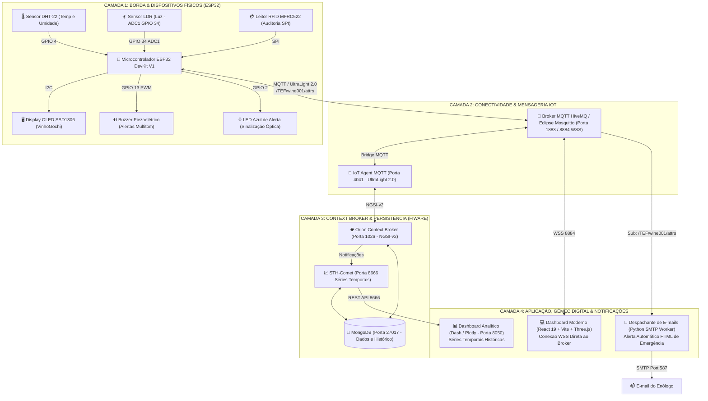

# 🍷 VinheriaTech — Sistema Inteligente de Supervisão, Auditoria e Gêmeo Digital para Adegas

<p align="center">
  
  
  
  
  
  
</p>

> **Check Point 5 — Edge Computing e Computer Systems**  
> **Orientador:** Prof. Dr. Fábio Henrique Cabrini  
> **Instituição:** FIAP  
> **Equipe de Desenvolvimento:** Equipe Prisma  
> **Simulação no Wokwi:** [wokwi.com/projects/479000065440928769](https://wokwi.com/projects/479000065440928769)  

---

## 📑 Sumário Executivo
- [1. Visão Geral da Solução](#-1-visão-geral-da-solução)
- [2. Diferenciais e Inovações Tecnológicas](#-2-diferenciais-e-inovações-tecnológicas)
- [3. Arquitetura da Solução em Camadas](#-3-arquitetura-da-solução-em-camadas)
- [4. Especificação de Hardware e Pinagem](#-4-especificação-de-hardware-e-pinagem)
- [5. Estrutura do Repositório](#-5-estrutura-do-repositório)
- [6. Guia de Execução Passo a Passo](#-6-guia-de-execução-passo-a-passo)
  - [A. Simulação no Wokwi](#a-simulação-do-hardware-no-wokwi)
  - [B. Dashboard Web Moderno (React 19 + 3D)](#b-dashboard-web-moderno-react-19--threejs)
  - [C. Serviço de E-mails de Emergência (Python Worker)](#c-serviço-de-e-mails-de-emergência-email_dispatcherpy)
  - [D. Dashboard Alternativo em Python (Dash/Plotly)](#d-dashboard-analítico-alternativo-dashboardpy)
  - [E. Stack FIWARE Local via Docker](#e-stack-fiware-local-via-docker-opcional)
- [7. Protocolo de Comunicação e Mensageria](#-7-protocolo-de-comunicação-e-mensageria)
- [8. Guia para Apresentação e Demonstração Prática](#-8-guia-para-apresentação-e-demonstração-prática)
- [9. Integrantes do Grupo e Licença](#-9-integrantes-do-grupo--licença)

---

## 📌 1. Visão Geral da Solução

O **VinheriaTech** é um sistema cibernético-físico de alta precisão projetado para a supervisão microclimática contínua, auditoria de segurança presencial e mitigação de perdas em caves de vinhos nobres e vinícolas industriais.

### O Problema Enológico
Vinhos de alta gama e rótulos de guarda (*Gran Reserva*) demandam condições ambientais milimetricamente estáveis para garantir o processo de polimerização e evolução em garrafa:
* **Temperatura Crítica (12°C a 16°C):** Oscilações superiores aceleram a oxidação, degradam compostos aromáticos e dilatam o líquido, forçando a expulsão da rolha. Temperaturas inferiores induzem à precipitação de cristais tartáricos e interrompem a maturação.
* **Umidade Relativa (60% a 75%):** Ambientes secos (< 50%) ressecam a cortiça natural da rolha, gerando microfissuras que admitem oxigênio externo e convertem o vinho em ácido acético (vinagre). Umidade excessiva (> 80%) fomenta o mofo nos rótulos e deteriora o exterior da rolha.
* **Luminosidade Ambiente (< 30% / escuro contínuo):** A exposição à radiação ultravioleta e luz visível induz o chamado *"gout de lumière"* (defeito de luz), foto-oxidando os taninos e quebrando moléculas de riboflavina.

### A Solução VinheriaTech
A solução combina computação de borda baseada em **ESP32**, protocolos de IoT industrial (**MQTT / UltraLight 2.0**), o ecossistema aberto **FIWARE (Orion, STH-Comet, IoT Agent)**, uma aplicação web de última geração em **React 19 com Gêmeo Digital 3D (Three.js)** e um **robô de e-mails de emergência em Python (SMTP)**.

---

## 🚀 2. Diferenciais e Inovações Tecnológicas

```
┌──────────────────────────────────────────────────────────────────────────────────┐
│                             DESTAQUES DE ENGENHARIA                              │
├───────────────────────┬──────────────────────────┬───────────────────────────────┤
│   🛡️ AUDITORIA RFID   │    🍇 MASCOTE DINÂMICO   │      🌐 GÊMEO DIGITAL 3D      │
│  Silenciamento seguro │   Expressões em tempo    │    Espelho bidirecional em    │
│  com crachá físico    │   real no display OLED   │     Three.js e WebSockets     │
├───────────────────────┴──────────────────────────┴───────────────────────────────┤
│                     ⚡ CALIBRAÇÃO DINÂMICA CROSS-DEVICE                         │
│       Sincronização assíncrona em tempo real entre PC e Celular via MQTT         │
└──────────────────────────────────────────────────────────────────────────────────┘
```

### 1. Auditoria e Reconhecimento Presencial com RFID (MFRC522)
* Em incidentes industriais, **um alarme crítico não pode ser silenciado à distância sem a presença de um responsável no local**.
* Quando uma anomalia ambiental ocorre, o buzzer emite alertas sonoros contínuos. O alarme só é reconhecido e silenciado após o enólogo responsável aproximar seu **Cartão Master (UID: `01:02:03:04`)** do leitor RFID.
* O microcontrolador registra o evento, emite um bip harmônico de confirmação, envia o log de auditoria ao broker MQTT e o dashboard exibe instantaneamente a matrícula e o horário do operador. Cartões não autorizados recebem um tom grave de rejeição.

### 2. Interface Gamificada "VinhoGochi" no Display Gráfico
* Substitui textos brutos por um mascote virtual dinâmico estilizado no display (SSD1306 / ST7735S) e no dashboard web, permitindo diagnósticos visuais imediatos mesmo a longa distância:
  * **Feliz `( ^_^ )`:** Condições microclimáticas em perfeito equilíbrio.
  * **Calor `( ;_; )`:** Gotas de transpiração na tela (estresse térmico).
  * **Frio `( >_< )`:** Mascote tremendo de frio.
  * **Ressecamento / Umidade Crítica `( X_X )`:** Risco severo à integridade da rolha.
  * **Luz Excessiva `( *O* )`:** Mascote com óculos escuros contra fotodegradação.
  * **Pânico / Emergência `( !_! )`:** Alarme em disparo contínuo.
  * **Reconhecido `( B-) )`:** Crachá Master aceito com sucesso.

### 3. Gêmeo Digital 3D Interativo (Digital Twin)
* O dashboard em React conta com um modelo tridimensional renderizado em **Three.js** que reflete o estado físico real da adega em tempo real:
  * O LED azul virtual pulsa na tela na mesma cadência do circuito físico.
  * O buzzer e o leitor RFID são modelados interativamente.
  * As métricas de telemetria recebidas via **WebSockets WSS (`wss://broker.hivemq.com:8884/mqtt`)** animam o ambiente 3D sem necessidade de recarregar a página.

### 4. Despachante Automático de E-mails de Emergência
* Um microserviço assíncrono em Python monitora o tráfego MQTT 24/7.
* Ao detectar violações extremas de conservação (ex.: temperatura $> 20^\circ\text{C}$ ou $< 10^\circ\text{C}$, ou umidade $> 85\%$), gera e dispara imediatamente um **e-mail HTML estilizado** com a paleta formal da vinheria diretamente para a caixa postal do enólogo responsável.
* Possui trava de segurança (*cooldown* de 25s) para evitar sobrecarga de envios e salva uma cópia de auditoria na pasta `outbox_emails/`.

### 5. Calibração Dinâmica Sincronizada em Tempo Real (PC ⇄ Celular)
* **Sincronização Assíncrona Bidirecional:** Qualquer ajuste nas faixas de corte da adega (Temperatura Mín/Máx, Umidade Mín/Máx e Luz Máx) realizado no computador do operador é refletido **instantaneamente no celular do enólogo na ronda** (e vice-versa), via canal de mensageria MQTT no tópico `/TEF/wine001/triggers`.
* **Persistência em Nuvem com Mensagens Retidas (Retain MQTT):** As calibrações são publicadas com `retain: true` no broker HiveMQ. Isso garante que, mesmo que o celular seja aberto horas após o ajuste no PC, ele já carregue imediatamente a calibração mais recente salva na nuvem.
* **Debounced Live Broadcast:** Ao deslizar os seletores no navegador, os novos limites são transmitidos com debounce de 280ms, atualizando em tempo real as curvas dos gráficos históricos, os cartões de telemetria e o firmware do ESP32 via `/TEF/wine001/cmd`.
* **Identificação de Origem no Painel:** A interface exibe visualmente qual dispositivo realizou o ajuste (`📲 Sincronizado via Computador` ou `💻 Sincronizado via Celular`).

---

## 🏗️ 3. Arquitetura da Solução em Camadas



---

## 🔌 4. Especificação de Hardware e Pinagem

### Tabela de Pinagem do ESP32 DevKit V1

| Componente | Pino do Módulo | Pino no ESP32 | Barramento / Tipo | Função no Sistema |
| :--- | :--- | :--- | :--- | :--- |
| **DHT-22 / DHT-11** | DATA / OUT | **GPIO 4** | Digital One-Wire | Medição de Temperatura (-40 a 80°C) e Umidade (0 a 100%) |
| | VCC | **3V3** | Alimentação | Tensão regulada de 3.3V |
| | GND | **GND** | Terra | Referência de potencial elétrico |
| **LDR (Fotoresistor)** | AO (Analógico) | **GPIO 34** | Analógico ADC1_CH6 | Leitura luminosa (0 a 100%). *Imune a interferência de Wi-Fi* |
| | VCC | **3V3** | Alimentação | Tensão regulada de 3.3V |
| | GND | **GND** | Terra | Referência de potencial elétrico |
| **Display OLED SSD1306** | SDA | **GPIO 21** | **I2C** | Barramento de dados gráficos |
| | SCL | **GPIO 22** | **I2C** | Barramento de clock do display |
| | VCC | **3V3** | Alimentação | Tensão regulada de 3.3V |
| | GND | **GND** | Terra | Referência de potencial elétrico |
| **Leitor RFID MFRC522** | SDA (SS) | **GPIO 5** | **SPI (VSPI)** | Slave Select (CS) do módulo RFID |
| | SCK | **GPIO 18** | **SPI (VSPI)** | Clock de sincronização SPI |
| | MOSI | **GPIO 23** | **SPI (VSPI)** | Master Out Slave In |
| | MISO | **GPIO 19** | **SPI (VSPI)** | Master In Slave Out |
| | RST | **GPIO 27** | Digital Output | Reset de hardware do leitor RFID |
| | 3.3V | **3V3** | Alimentação | Tensão regulada de 3.3V |
| | GND | **GND** | Terra | Referência de potencial elétrico |
| **Buzzer Piezoelétrico** | Pino Positivo (+) | **GPIO 13** | Digital PWM (`ledc`) | Emissão de frequências sonoras distintas por falha |
| | Pino Negativo (-) | **GND** | Terra | Referência de potencial elétrico |
| **LED Azul de Emergência** | Ânodo (+) | **GPIO 2** | Digital Output | Alerta visual óptico (com resistor de 220 $\Omega$) |
| | Cátodo (-) | **GND** | Terra | Referência de potencial elétrico |

### Padrões de Frequência Sonora do Buzzer
* **Anomalia Térmica (Calor/Frio):** `2500 Hz` intermitente rápido (bips a cada 150 ms).
* **Anomalia de Umidade:** `1200 Hz` pulsado médio (500 ms ligado / 500 ms desligado).
* **Anomalia de Luminosidade:** `800 Hz` tom longo a cada 1000 ms.
* **Alerta Extremo / Crítico:** Tom contínuo ininterrupto de alta intensidade.
* **Confirmação de Reconhecimento RFID:** Bip duplo harmônico ascendente (`1500 Hz` $\to$ `2400 Hz`).
* **Cartão RFID Não Autorizado:** Tom grave de rejeição (`350 Hz` por 500 ms).

---

## 📁 5. Estrutura do Repositório

```text
CP5/
├── CP5.ino                                    # Firmware C++ completo para ESP32
├── diagram.json                               # Layout esquemático de fiação do Wokwi
├── wokwi.toml                                 # Configuração de emulação Wokwi no VS Code
├── libraries.txt                              # Dependências de bibliotecas C++ do Wokwi
├── logo_bmp.h                                 # Bitmap do logotipo para displays gráficos
├── email_dispatcher.py                        # Worker Python para envio automático de e-mails de alerta
├── dashboard.py                               # Dashboard analítico em Python Dash / Plotly
├── requirements.txt                           # Dependências das aplicações em Python
├── GUIA_MONTAGEM_HARDWARE_ST7735S_E_VINCULACAO.md # Manual adicional de hardware e display TFT
├── outbox_emails/                             # Pasta com logs locais dos e-mails HTML disparados
├── frontend/                                  # Aplicação Web Moderna (SPA)
│   ├── package.json                           # Dependências (React 19, Vite, Tailwind, Three.js)
│   ├── vite.config.ts                         # Configuração do bundler Vite
│   ├── src/
│   │   ├── main.tsx                           # Ponto de entrada da aplicação
│   │   ├── App.tsx                            # Orquestração do estado global e conexão MQTT
│   │   └── components/                        # Módulos reutilizáveis
│   │       ├── TelemetryCards.tsx             # Indicadores de temperatura, umidade e luz
│   │       ├── DigitalTwinMirror.tsx          # Gêmeo Digital com visualização 3D (Three.js)
│   │       ├── CellarStatusPanel.tsx          # Painel de diagnóstico do estado da cave
│   │       ├── InteractiveCharts.tsx          # Curvas temporais e bandas de tolerância
│   │       ├── TriggersCalibration.tsx        # Calibração remota de limites ambientais
│   │       ├── AlertHistoryTable.tsx          # Histórico de incidentes e auditoria RFID
│   │       ├── EmailAlertModal.tsx            # Central de monitoramento dos disparos de e-mail
│   │       ├── DeviceManagerModal.tsx         # Provisionamento de novos dispositivos IoT
│   │       ├── TutorialModal.tsx              # Guia interativo integrado à interface
│   │       └── PrismaIntroSplash.tsx          # Animação inicial de boas-vindas
│   └── public/                                # Ativos estáticos e ícones
```

---

## 💻 6. Guia de Execução Passo a Passo

### Pré-requisitos
* [Node.js](https://nodejs.org/) versão 18+ e `npm` instalados.
* [Python](https://www.python.org/) versão 3.10+ instalado.
* [VS Code](https://code.visualstudio.com/) com a extensão **Wokwi Simulator** instalada (ou acesso via navegador ao [Wokwi Web](https://wokwi.com/)).

---

### A. Simulação do Hardware no Wokwi

#### Opção 1: Diretamente no VS Code (Recomendado)
1. Abra a pasta do projeto no VS Code.
2. Pressione **`Ctrl + Shift + B`** para compilar o firmware [`CP5.ino`](./CP5.ino).
3. Abra o arquivo [`diagram.json`](./diagram.json).
4. Pressione **`F1`** (ou `Ctrl + Shift + P`) e selecione **`Wokwi: Start Simulator`** (ou clique no botão verde de Play).
5. O console serial exibirá a conexão Wi-Fi simulada e a publicação contínua no broker MQTT (`broker.hivemq.com`).

#### Opção 2: Pelo Navegador (Wokwi Web)
> 🔗 **Projeto pronto no Wokwi:** [https://wokwi.com/projects/479000065440928769](https://wokwi.com/projects/479000065440928769) — basta abrir o link e clicar em **Play**.

Para montar o projeto manualmente:
1. Acesse [wokwi.com](https://wokwi.com/) e inicie um novo projeto para **ESP32**.
2. Copie o código de [`CP5.ino`](./CP5.ino) para o editor de código.
3. Cole o conteúdo de [`diagram.json`](./diagram.json) na aba correspondente.
4. Adicione as bibliotecas listadas em [`libraries.txt`](./libraries.txt) no **Library Manager**.
5. Clique em **Play** para iniciar a simulação.

---

### B. Dashboard Web Moderno (React 19 + Three.js)

O frontend conecta-se diretamente ao broker HiveMQ via WebSocket seguro (`wss://broker.hivemq.com:8884/mqtt`). Ele não necessita de intermediários locais para receber a telemetria do Wokwi!

1. Abra um terminal e acesse a pasta `frontend`:
   ```bash
   cd frontend
   ```
2. Instale as dependências:
   ```bash
   npm install
   ```
3. Inicie o servidor de desenvolvimento:
   ```bash
   npm run dev
   ```
4. Acesse no navegador o endereço indicado (geralmente **`http://localhost:3000`** ou **`http://localhost:5173`**).

---

### C. Serviço de E-mails de Emergência (`email_dispatcher.py`)

O serviço assíncrono escuta o tópico `/TEF/wine001/attrs`. Sempre que a temperatura for $> 20^\circ\text{C}$ ou $< 10^\circ\text{C}$, ou a umidade $> 85\%$, ele envia um e-mail HTML formal para o endereço configurado.

1. No terminal raiz do projeto, instale os requisitos:
   ```bash
   pip install -r requirements.txt
   ```
2. *(Opcional)* Configure suas variáveis de ambiente para envio de e-mails reais via Gmail:
   * No Windows PowerShell:
     ```powershell
     $env:SMTP_USER="seu_email@gmail.com"
     $env:SMTP_PASS="sua_senha_de_app_16_digitos"
     $env:ALERT_RECIPIENT_EMAIL="email_destinatario@gmail.com"
     ```
   * No Linux / macOS:
     ```bash
     export SMTP_USER="seu_email@gmail.com"
     export SMTP_PASS="sua_senha_de_app_16_digitos"
     export ALERT_RECIPIENT_EMAIL="email_destinatario@gmail.com"
     ```
   > **Nota de Segurança Google:** Para o Gmail, a senha deve ser uma **Senha de App de 16 caracteres** gerada em: [myaccount.google.com/apppasswords](https://myaccount.google.com/apppasswords).
3. Execute o script:
   ```bash
   python email_dispatcher.py
   ```
4. Se nenhuma credencial for informada, o serviço continuará monitorando e gerará os arquivos HTML dos e-mails na pasta `outbox_emails/` para visualização e auditoria local.

---

### D. Dashboard Analítico Alternativo (`dashboard.py`)

Caso deseje visualizar séries temporais históricas em um ambiente baseado em Python:
1. Execute:
   ```bash
   python dashboard.py
   ```
2. Abra no navegador: **`http://localhost:8050`**

---

### E. Stack FIWARE via Docker ou Nuvem (Opcional)

Por padrão, a solução utiliza o broker público HiveMQ (`broker.hivemq.com`), dispensando qualquer instalação de Docker local. Caso deseje executar a stack FIWARE clássica (Orion na porta 1026, IoT Agent na 4041 e STH-Comet na 8666):
1. Execute sua stack Docker (`docker compose up -d`) ou aponte para o IP da VM do laboratório.
2. Provisione o Service Group no IoT Agent (porta 4041):
   ```bash
   curl -iX POST 'http://localhost:4041/iot/services' \
     -H 'Content-Type: application/json' \
     -H 'fiware-service: smart' \
     -H 'fiware-servicepath: /' \
     -d '{
       "services": [
         {
           "apikey": "TEF",
           "cbroker": "http://orion:1026",
           "entity_type": "WineCellar",
           "resource": ""
         }
       ]
     }'
   ```
3. Provisione o dispositivo `wine001`:
   ```bash
   curl -iX POST 'http://localhost:4041/iot/devices' \
     -H 'Content-Type: application/json' \
     -H 'fiware-service: smart' \
     -H 'fiware-servicepath: /' \
     -d '{
       "devices": [
         {
           "device_id": "wine001",
           "entity_name": "urn:ngsi-ld:WineCellar:001",
           "entity_type": "WineCellar",
           "protocol": "PDI-IoTA-UltraLight",
           "transport": "MQTT",
           "commands": [
             { "name": "alarm_on", "type": "command" },
             { "name": "alarm_off", "type": "command" },
             { "name": "alarm_temp", "type": "command" },
             { "name": "alarm_hum", "type": "command" },
             { "name": "alarm_lum", "type": "command" },
             { "name": "set_triggers", "type": "command" }
           ],
           "attributes": [
             { "object_id": "t", "name": "temperature", "type": "Float" },
             { "object_id": "h", "name": "humidity", "type": "Float" },
             { "object_id": "l", "name": "luminosity", "type": "Integer" },
             { "object_id": "alarm", "name": "alarmState", "type": "Integer" },
             { "object_id": "ack", "name": "ackState", "type": "Integer" },
             { "object_id": "rfid", "name": "lastOperator", "type": "Text" }
           ]
         }
       ]
     }'
   ```

---

## 📡 7. Protocolo de Comunicação e Mensageria

A comunicação adota o protocolo **UltraLight 2.0 sobre MQTT**, estruturado em pares de chave-valor separados por barras verticais (`|`):

* **Tópico de Telemetria (ESP32 $\to$ Nuvem):** `/TEF/wine001/attrs`
* **Exemplo de Payload:**
  ```text
  t|14.2|h|68.0|l|15|alarm|0|ack|0|rfid|01:02:03:04
  ```
  * `t`: Temperatura em graus Celsius (°C).
  * `h`: Umidade relativa do ar (%).
  * `l`: Luminosidade ambiente (0 a 100%).
  * `alarm`: Estado do alarme (`0` = Normal, `1` = Crítico, `2` = Emergência Extrema).
  * `ack`: Estado de reconhecimento presencial (`0` = Pendente, `1` = Silenciado por RFID).
  * `rfid`: UID do último cartão lido no sensor físico.

* **Tópico de Log de Auditoria:** `/TEF/wine001/attrs/log`
* **Tópico de Comandos Remotos (Dashboard $\to$ ESP32):** `/TEF/wine001/cmd`
* **Tópico de Calibração Dinâmica Sincronizada (PC ⇄ Celular):** `/TEF/wine001/triggers`
  * **Payload (JSON Retained):**
    ```json
    {
      "tempMin": 12.0,
      "tempMax": 16.0,
      "humMin": 60.0,
      "humMax": 75.0,
      "lumMax": 30,
      "sender": "vinheria_pc_7a8b9c",
      "deviceType": "Computador",
      "timestamp": 1728956000000
    }
    ```

---

## 🎯 8. Guia para Apresentação e Demonstração Prática

Para garantir o melhor impacto na demonstração ao vivo:

1. **Abertura do Problema (30s):** Explique que a perda de temperatura ou incidência luminosa em adegas de vinhos nobres causa oxidação irreversível em safras que custam dezenas de milhares de reais.
2. **Demonstração em Tempo Real (1 min):** Coloque a janela do Wokwi e a do Dashboard Web (React 19) lado a lado na tela. Aponte para o display OLED com o mascote "VinhoGochi" feliz e o Gêmeo Digital 3D sincronizado.
3. **Calibração Dinâmica Cross-Device (1 min):** Abra o site no computador e no smartphone simultaneamente. Deslize os limites de temperatura no celular e mostre a tela do computador atualizando no mesmo milissegundo com o aviso *"Sincronizado via Celular"*, sincronizando também o firmware do ESP32 via MQTT.
4. **Simulação de Anomalia Térmica (1 min):** No Wokwi, clique no sensor DHT-22 e eleve a temperatura para **$24^\circ\text{C}$**.
   * O mascote mudará para suor/desespero `(;_;)`.
   * O LED azul piscará continuamente.
   * O buzzer tocará o alarme de alta frequência.
   * O Dashboard acusará anomalia e registrará o evento no histórico.
   * O worker Python despachará o e-mail de alerta em segundo plano.
5. **O Grande Diferencial — Auditoria Presencial por RFID (1 min):** Aproxime o Cartão Master (`01:02:03:04`) do leitor MFRC522 no Wokwi (clique em *Tap* no cartão azul).
   * O som do alarme cessa na hora.
   * O display confirma: `ACK: OP MASTER [OK]`.
   * A tabela de auditoria do frontend é atualizada na hora com o horário do atendimento e a matrícula do operador.
6. **Encerramento Técnico (30s):** Destaque a conformidade com as normas FIWARE, o desacoplamento de microsserviços, a sincronização cross-device via WebSockets MQTT e o firmware 100% não-bloqueante baseado em `millis()`.

---

## 👥 9. Integrantes do Grupo & Licença

### 👥 Integrantes — Equipe Prisma
* **João Gabriel Vieira Mesquita** — RM: 573685
* **Ian Felipe Tassiotto Gomes** — RM: 570812
* **Hyan Hideo Silveira Teodoro Ayabe** — RM: 571005
* **Elizeu Antônio de Queiroz** — RM: 569433
* **Guilherme de Sousa Caiano** — RM: 570491

* **Projeto Acadêmico:** FIAP
* **Disciplina:** Edge Computing e Computer Systems
* **Orientação:** Prof. Dr. Fábio Henrique Cabrini

### Licença
Este projeto é distribuído sob os termos da licença educacional para avaliação acadêmica no Check Point 5.
